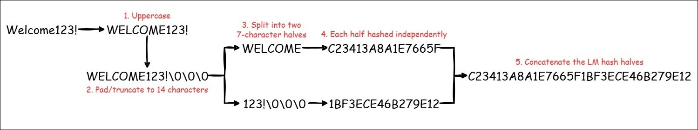

# LM workflows

The `lm` command provides standalone workflows for mapping recovered LM
passwords to accounts and generating case variants for recovered passwords.

The end-to-end [`audit`](audit.md) workflow automates LM result
reconstruction and mapping when LM hashes are present.

## Why Hashcat `--show` is needed

LM hashes are made from two independently hashed seven-character password 
halves.



Hashcat's LM mode (`3000`) records recovered halves in its potfile, but the 
account-mapping workflow needs the full LM hash and the reconstructed password. 
The potfile's half-hash entries therefore cannot be joined directly to the full 
LM hashes in the NTDS data.

Run Hashcat with `--show` against the original full LM hashes to combine any
recovered halves into results keyed by the full LM hash.

The `password-audit lm map` command uses those results to map recovered 
passwords back to accounts.

## LM recovery and mapping

The standalone workflow has two steps:

1. Use Hashcat with LM mode (`3000`) and `--show` to reconstruct results from
   the recovered halves.
2. Pass the NTDS export, Hashcat potfile, and `--show` results to `lm map`.

```bash
hashcat -m 3000 --show password-audit/lm-hashes.txt \
    --potfile-path /path/to/hashcat.potfile \
    > password-audit/lm-results.txt

password-audit lm map \
    --ntds company.ntds \
    --potfile /path/to/hashcat.potfile \
    --lm-results password-audit/lm-results.txt
```

When matches are found, the mapped records are written to
`password-audit/mapped-lm-passwords.txt`. The output directory can be changed
with `--output-dir`.

| Option | Purpose |
| --- | --- |
| `-N`, `--ntds` | NTDS export. |
| `-P`, `--potfile` | Hashcat potfile. |
| `-R`, `--lm-results` | Results produced by Hashcat `--show`. |
| `-O`, `--output-dir` | Output directory; defaults to `password-audit`. |

Unlike the standalone workflow, `audit` runs the LM `--show` and mapping steps
for you. It invokes Hashcat with the following command shape and saves the
output for mapping:

```text
<hashcat_binary> -m 3000 --show <lm_hash_file> --potfile-path <potfile>
```

If an LM campaign is included in the campaign file, `audit` also runs it when
LM hashes are present. LM reconstruction uses that campaign's Hashcat
binary and potfile; without an LM campaign, it uses the NTLM campaign's
configuration. If `--show` fails, the audit stops rather than reporting an
empty LM recovery.

## Generate case variants

LM hashes do not preserve character case. The `lm generate` command writes
recovered LM passwords and their possible case variants:

```bash
password-audit lm generate \
    --mapped-lm-passwords password-audit/20261123-135252/mapped-lm-passwords.txt
```

By default, the command reads `domain-admins.txt` from the same directory as
the mapped LM passwords, if present, and selects only Domain Administrator
accounts. Use `--domain-admins` to specify another list. If no default list
exists, the command warns and generates variants for all mapped LM passwords.
An explicitly specified list must exist.

The default output directory is `password-audit/`. When a list is available,
the command creates:

| File | Contents |
| --- | --- |
| `lm-da-users.txt` | Domain Administrator accounts with recovered LM passwords. |
| `lm-da-passwords.txt` | Matching recovered passwords. |
| `lm-da-candidates.txt` | Generated capitalisation variants. |

Without a list, the equivalent files are `lm-all-users.txt`,
`lm-all-passwords.txt`, and `lm-all-candidates.txt`. These files include all
mapped accounts and must not be interpreted as identifying administrators.

The number of variants grows exponentially with the number of alphabetic
characters. Review the output size and handle generated candidates securely.
Use candidate data only within an explicitly authorised assessment.

The command accepts `--domain-admins` to use a different account list and
`--output-dir` to change the destination. Run `password-audit lm --help` or
`password-audit lm generate --help` for the full option list.

## LM findings in reports

To include LM information in a standalone analysis, provide the mapped LM
dataset alongside the required mapped NTLM dataset:

```bash
password-audit analyse \
    --mapped-ntlm-passwords password-audit/mapped-ntlm-passwords.txt \
    --mapped-lm-passwords password-audit/mapped-lm-passwords.txt
```

The corresponding `lm-users.txt` must also be available beside the mapped
NTLM dataset or supplied with `--lm-users`.

The report includes LM hash presence and, where applicable, Domain
Administrator LM exposure and LM recovery statistics. See
[`analyse`](analyse.md#what-is-analysed) for the full analysis scope.
